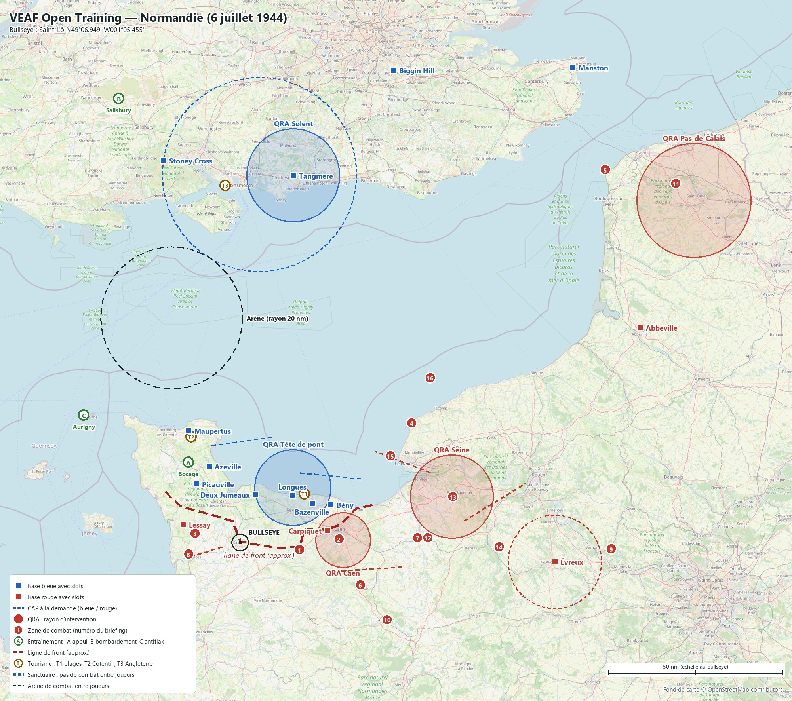
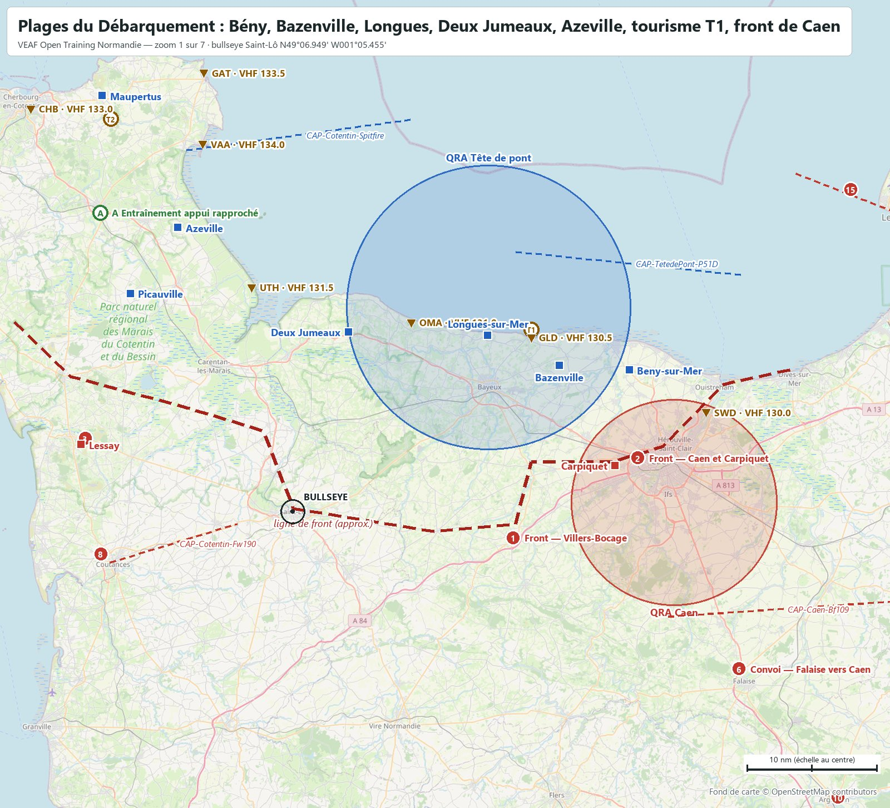
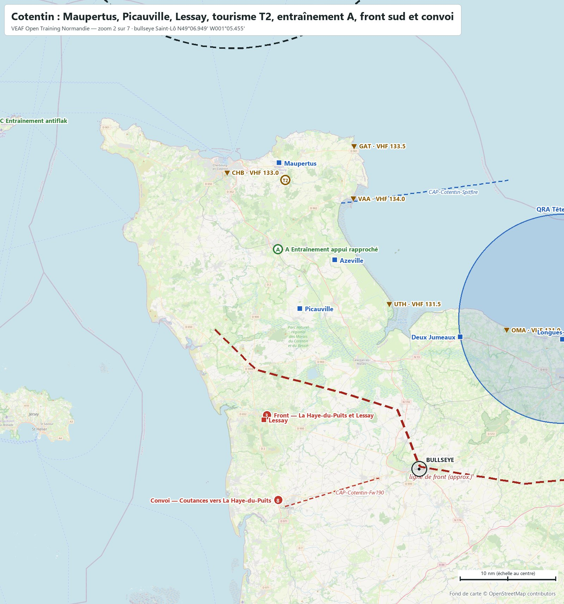
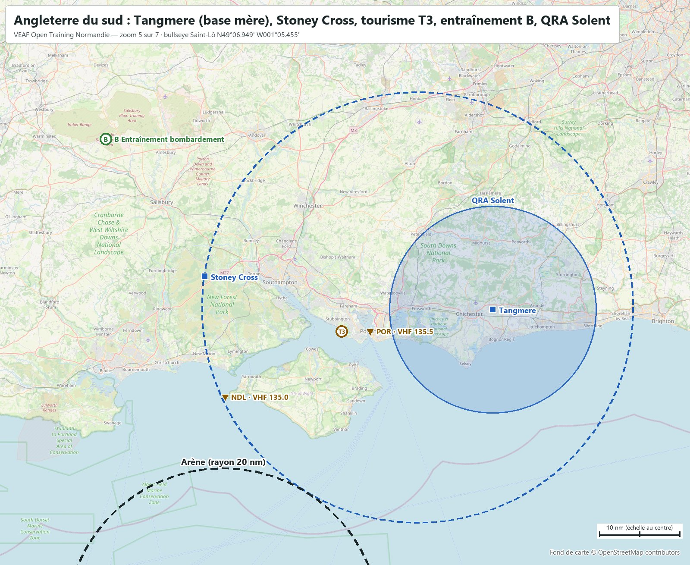
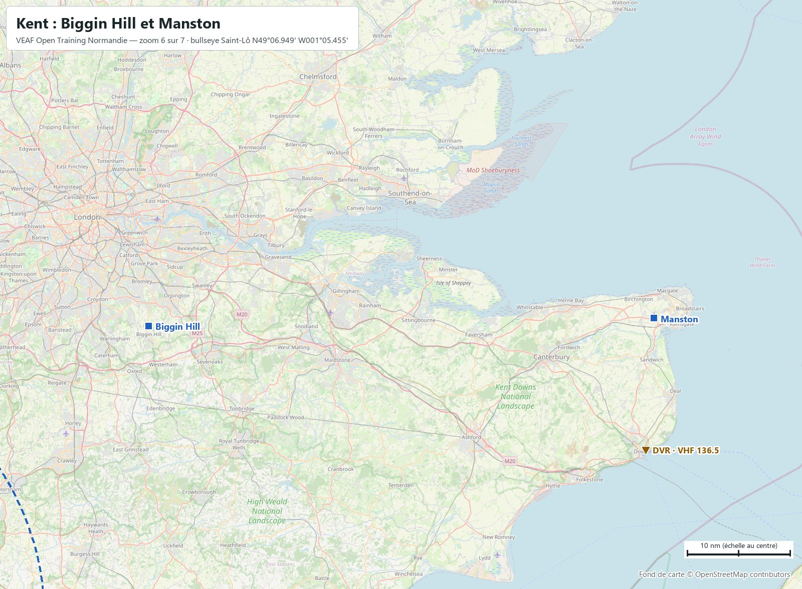
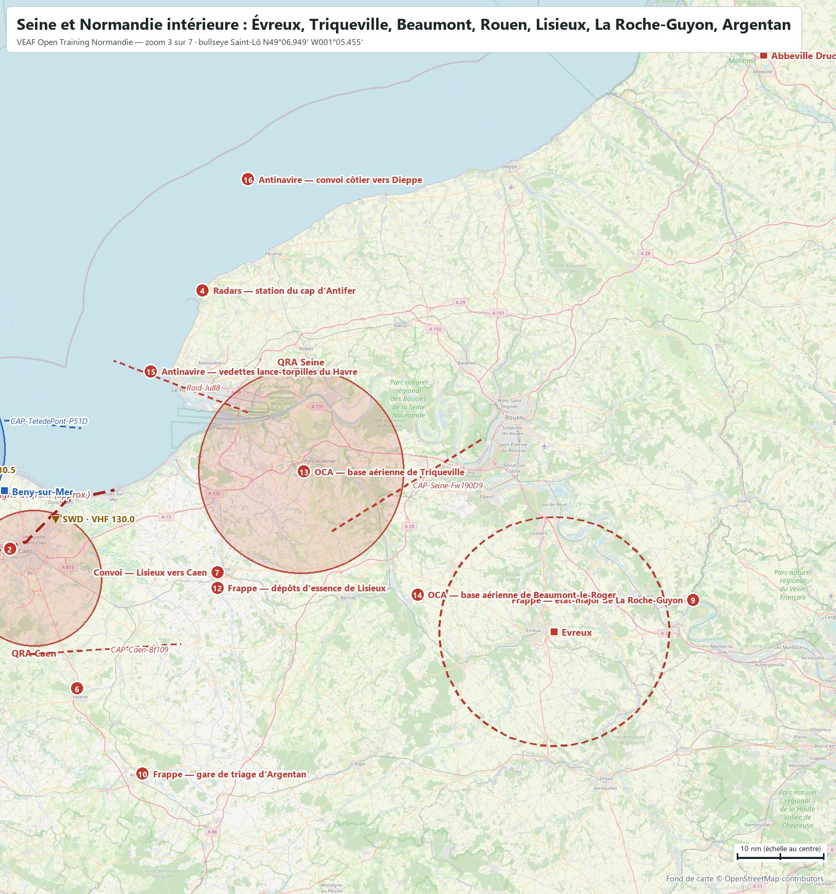
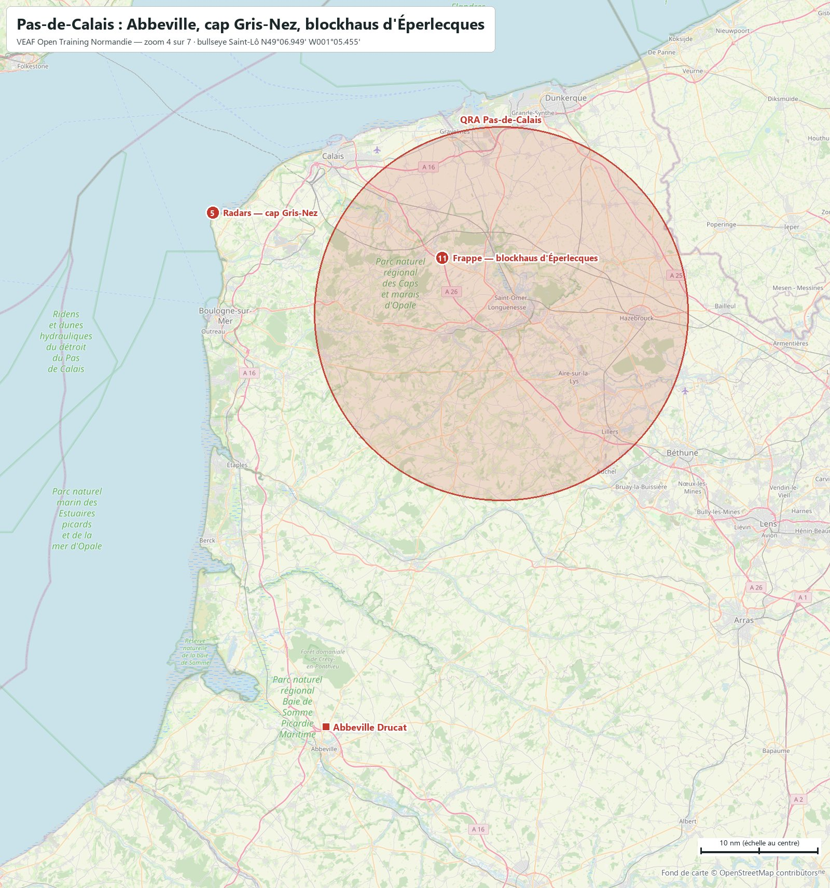
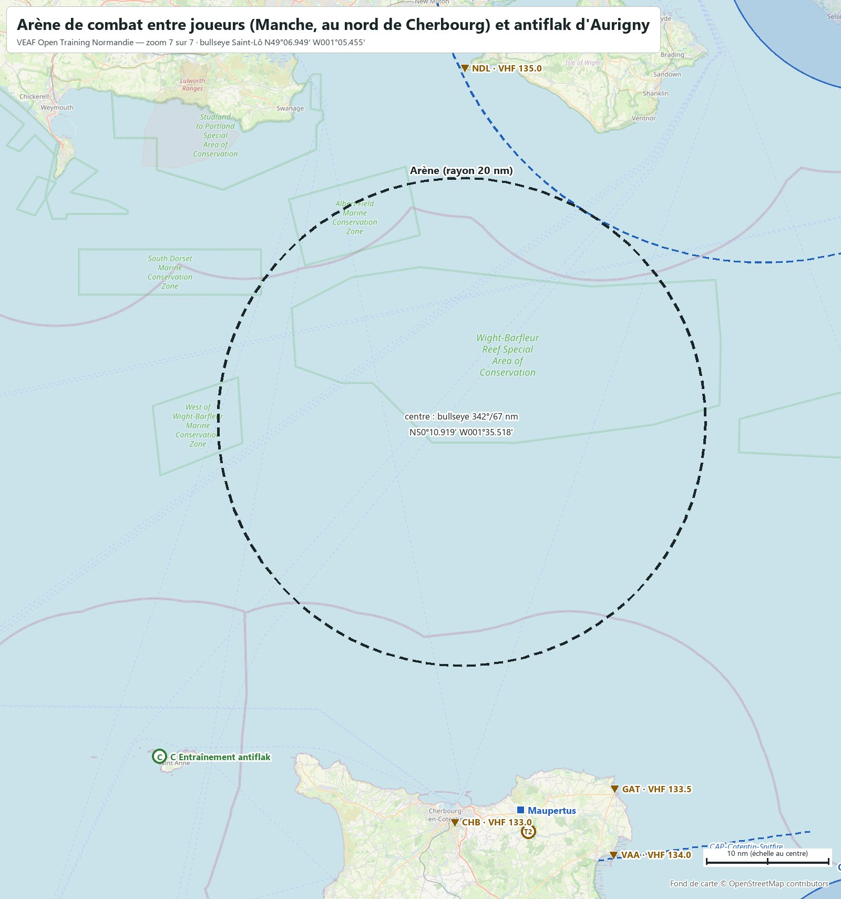

# VEAF Open Training — Normandie (6 juillet 1944)

Mission d'entraînement ouverte des serveurs VEAF, sur la carte **Normandy** de DCS, au 6 juillet 1944 : trente jours après le Débarquement. Ce document est le briefing complet : bases, zones, QRA, CAP, radio, météo. Les positions sont données en coordonnées (degrés, minutes décimales) et en relèvement/distance depuis le bullseye (relèvement vrai, nautiques).

| Mission | Date | Heure de base | Bullseye (bleu et rouge) | Météo | ATC |
|---|---|---|---|---|---|
| `VEAF_OpenTraining_Normandy_ICAO_LFRK` | 06/07/1944 | 09:00 (heure de la carte) | Saint-Lô · `N49°06.949' W001°05.455'` | celle du serveur VEAF | coupé sur tous les aérodromes |

**Sommaire** : [Situation](#situation) · [Carte](#carte) · [Bases](#bases) · [Soutien](#soutien) · [Entraînement](#entraînement) · [Tourisme](#tourisme) · [Zones de combat](#zones-de-combat) · [Missions scénarisées](#missions-scénarisées) · [QRA](#qra) · [CAP à la demande](#cap-à-la-demande) · [Combat entre joueurs](#combat-entre-joueurs) · [Défense aérienne](#défense-aérienne) · [Plan radio](#plan-radio) · [Météo et heures](#météo-et-heures) · [Commandes utiles](#commandes-utiles) · [Pour les créateurs de mission](#pour-les-créateurs-de-mission)

## Situation

D+30. La tête de pont alliée tient Cherbourg (tombé les 26-29 juin), le Cotentin jusqu'à Carentan et l'ouest de Caen ; l'Angleterre du sud est la base arrière. Le front, tracé à l'estime donc **approximatif** (73 nm), court de la côte ouest du Cotentin, par Carentan, Saint-Lô, Caumont et Villers-Bocage, à Carpiquet et à l'Orne. Au-delà, la France jusqu'à Paris et au Pas-de-Calais, plus les îles Anglo-Normandes, est rouge. Le bullseye commun est Saint-Lô, au milieu du front.

La version 5 n'avait que quatre zones de combat et trois bases à slots bleues ; la v6 en compte 16, 11 bases bleues et 4 rouges à slots, des QRA, des CAP, des scénarios et trois circuits touristiques.

Zones de combat, missions et scénarios se pilotent par le menu radio F10 (*Zones de combat*, *Missions de combat*).

## Carte



Cartes zoomées, reprises dans les sections qu'elles illustrent : [Plages du Débarquement](docs/cartes/carte_01_plages.jpg) · [Cotentin](docs/cartes/carte_02_cotentin.jpg) · [Seine et Normandie intérieure](docs/cartes/carte_03_seine.jpg) · [Pas-de-Calais](docs/cartes/carte_04_calais.jpg) · [Angleterre du sud](docs/cartes/carte_05_solent.jpg) · [Kent](docs/cartes/carte_06_kent.jpg) · [Arène de combat entre joueurs (Manche, au nord de Cherbourg) et antiflak d'Aurigny](docs/cartes/carte_07_arene.jpg).

Carrés : bases avec slots (bleu / rouge). Pointillés : CAP à la demande. Cercles pleins : QRA. Pastilles vertes : entraînement (A appui rapproché, B bombardement, C antiflak). Pastilles marron T : circuits touristiques ; triangles marron : leurs balises. Pastilles rouges numérotées : zones de combat. Cercles en tirets : sanctuaires et arène. Fond OpenStreetMap ; la ligne de front est approximative. Le briefing DCS montre cette carte puis les zooms (flèches sous l'image, molette pour grossir) ; la carte F10 porte les mêmes dessins : front, zones, QRA, sanctuaires, circuits et arène.

## Bases

| Base | Camp | Position | Bullseye | VHF | Défense |
|---|---|---|---|---|---|
| **Azeville** | Bleu | `N49°28.859' W001°19.057'` | `337°/24 nm` | `118.35` | flak lourde (88 mm, 3,7 in) + flak légère (20 mm, 40 mm) + flak moyenne (37 mm) |
| **Bazenville** | Bleu | `N49°18.238' W000°33.884'` | `060°/24 nm` | `118.7` | flak lourde de zone + flak moyenne (37 mm) + flak légère (20 mm, 40 mm) |
| **Beny-sur-Mer** | Bleu | `N49°17.881' W000°25.597'` | `066°/28 nm` | `118.8` | flak moyenne (37 mm) + flak légère (20 mm, 40 mm) |
| **Biggin Hill** | Bleu | `N51°19.801' E000°01.899'` | `016°/140 nm` | `134.8` | flak lourde (88 mm, 3,7 in) + flak légère (20 mm, 40 mm) |
| **Deux Jumeaux** | Bleu | `N49°20.840' W000°58.849'` | `016°/15 nm` | `118.15` | flak moyenne (37 mm) + flak légère (20 mm, 40 mm) |
| **Longues-sur-Mer** | Bleu | `N49°20.560' W000°42.370'` | `046°/20 nm` | `118.55` | flak lourde (88 mm, 3,7 in) + flak légère (20 mm, 40 mm) + flak lourde de zone + radar Allies_Director |
| **Manston** | Bleu | `N51°20.545' E001°20.771'` | `033°/163 nm` | `118.25` | flak lourde (88 mm, 3,7 in) + flak légère (20 mm, 40 mm) |
| **Maupertus** | Bleu | `N49°38.988' W001°28.017'` | `334°/35 nm` | `120.35` | flak lourde (88 mm, 3,7 in) + flak légère (20 mm, 40 mm) |
| **Picauville** | Bleu | `N49°23.782' W001°24.669'` | `322°/21 nm` | `118.4` | flak légère (20 mm, 40 mm) + flak moyenne (37 mm) |
| **Stoney Cross** | Bleu | `N50°54.888' W001°39.193'` | `347°/110 nm` | `120.75` | flak lourde (88 mm, 3,7 in) + flak légère (20 mm, 40 mm) |
| **Tangmere** (base mère) | Bleu | `N50°50.746' W000°42.114'` | `007°/105 nm` | `119.3` | flak lourde (88 mm, 3,7 in) + flak moyenne (37 mm) + flak légère (20 mm, 40 mm) + radar Allies_Director |
| **Abbeville Drucat** | Rouge | `N50°08.288' E001°50.274'` | `059°/130 nm` | `118.05` | flak lourde (88 mm, 3,7 in) + flak moyenne (37 mm) + flak légère (20 mm, 40 mm) |
| **Carpiquet** | Rouge | `N49°10.508' W000°27.268'` | `080°/25 nm` | `118.6` | flak moyenne (37 mm) + flak légère (20 mm, 40 mm) |
| **Evreux** | Rouge | `N49°01.428' E001°12.796'` | `091°/91 nm` | `119.0` | flak lourde (88 mm, 3,7 in) + flak moyenne (37 mm) + flak légère (20 mm, 40 mm) |
| **Lessay** | Rouge | `N49°12.130' W001°30.501'` | `286°/17 nm` | `121.85` | flak moyenne (37 mm) + flak légère (20 mm, 40 mm) |

Slots dynamiques, démarrage moteur chaud, carburant et munitions illimités : bleus P-47D, P-51D, Spitfire LF IX et Mosquito ; rouges Bf 109 K-4 et Fw 190 A-8 et D-9. Les autres aérodromes de chaque camp lui appartiennent, sans slots : côté bleu les terrains d'Angleterre du sud et de la tête de pont, côté rouge ceux de la France occupée et des îles Anglo-Normandes. Aucun aérodrome neutre. Fréquences : celles que DCS donne à chaque tour (ATC coupé).

<table><tr><td width="50%"><a href="docs/cartes/carte_01_plages.jpg"></a><br><sub>Plages du Débarquement : Bény, Bazenville, Longues, Deux Jumeaux, Azeville, tourisme T1, front de Caen</sub></td><td width="50%"><a href="docs/cartes/carte_02_cotentin.jpg"></a><br><sub>Cotentin : Maupertus, Picauville, Lessay, tourisme T2, entraînement A, front sud et convoi</sub></td></tr><tr><td width="50%"><a href="docs/cartes/carte_05_solent.jpg"></a><br><sub>Angleterre du sud : Tangmere (base mère), Stoney Cross, tourisme T3, entraînement B, QRA Solent</sub></td><td width="50%"><a href="docs/cartes/carte_06_kent.jpg"></a><br><sub>Kent : Biggin Hill et Manston</sub></td></tr></table>

## Soutien

Il n'y a ni ravitailleur ni AWACS en 1944 : aucun n'est posé, aucun n'est annoncé. Pas de FARP ni d'hélicoptère non plus. Le soutien est celui de l'époque : des bases proches du front, la radio VHF, et les vols de bombardiers des scénarios (B-17G, Ju 88). Les bases de la tête de pont sont à quelques minutes du front ; l'Angleterre est à 80-135 nm.

## Entraînement

Loin du front ou à l'arrière, à quelques minutes d'une base. Trois niveaux par famille, chacun comprenant ceux d'en dessous. **Activez un seul niveau par famille à la fois.** Les cibles des niveaux faciles sont des véhicules immobiles, en tir interdit : chauds au pod, inertes.

### A — Appui rapproché : bocage du Cotentin (à l'ouest d'Azeville)

`N49°30.000' W001°28.200'` · bullseye `326°/27 nm` · rayon 1.3 nm · menu F10 « Entraînement appui rapproché »

- **A1 Mitraillage bocage — facile** — Champ de tir d'appui rapproché dans le bocage du Cotentin, à 6 nm à l'ouest d'Azeville : chars, blindés légers et camions immobiles en tir interdit, dépôts de carburant et casernement. À 11 nm du front, arrière bleu.
- **A2 Mitraillage bocage — moyen** — Champ de tir du bocage : un groupe blindé léger actif et de la flak légère de 20 mm (deux positions tirées au sort sur trois) en plus des cibles du niveau facile.
- **A3 Mitraillage bocage — difficile** — Champ de tir du bocage avec une défense courte portée réaliste : une batterie de flak de 37 mm (tirée au sort entre deux positions), de la flak de 20 mm et un second groupe blindé.

### B — Bombardement : plaine de Salisbury (Angleterre)

`N51°12.000' W001°58.800'` · bullseye `344°/130 nm` · rayon 1.3 nm · menu F10 « Entraînement bombardement »

- **B1 Bombardement Salisbury — facile** — Champ de tir de bombardement de la plaine de Salisbury, à 21 nm de Stoney Cross : bâtiments et véhicules fictifs immobiles en tir interdit (blockhaus, casernes, entrepôts, dépôt, gare). À 111 nm du front : aucun contact possible.
- **B2 Bombardement Salisbury — moyen** — Champ de tir de Salisbury : de la flak légère de 20 mm, deux positions sur trois tirées au sort, en plus des cibles du niveau facile.
- **B3 Bombardement Salisbury — difficile** — Champ de tir de Salisbury avec la flak lourde de l'époque : une batterie de pièces de 88 mm (tirée au sort entre deux positions) et une batterie de 37 mm en plus du niveau moyen.

### C — Antiflak : fort Tourgis (Aurigny, île rouge)

`N49°43.398' W002°14.148'` · bullseye `308°/58 nm` · rayon 0.8 nm · menu F10 « Entraînement antiflak »

- **C1 Antiflak Aurigny — facile** — Site antiflak du fort Tourgis, à Aurigny, à 1 nm de la piste d'Aurigny et 30 nm de Maupertus : une batterie de flak moyenne (37 mm), à détruire. À 32 nm du front, en territoire rouge.
- **C2 Antiflak Aurigny — moyen** — Site antiflak d'Aurigny : la flak lourde de 88 mm (une batterie sur deux positions) en plus de la batterie de 37 mm.
- **C3 Antiflak Aurigny — difficile** — Site antiflak d'Aurigny en réseau : un radar d'alerte Freya, un radar de conduite de tir Würzburg, un télémètre et deux projecteurs guident la flak lourde et moyenne.

## Tourisme

Trois circuits aériens, hors combat, avec une balise radio VHF/AM à chaque site (elle répète son indicatif en morse) et un guide qui parle à tout appareil d'un joueur passant sous 1 500 ft sol au-dessus d'un monument : un message par monument, renouvelé après 10 minutes. La zone F10 *Tourisme* fait seulement apparaître des véhicules d'époque et quelques soldats ; les balises et le guide sont permanents. La présence des monuments dans le décor DCS est à confirmer en jeu.

### T1 Tourisme — Plages du Débarquement

`N49°21.000' W000°37.200'` · bullseye `051°/23 nm` · menu F10 « Tourisme »

Visite aérienne « Plages du Débarquement », hors combat, à 3 nm de Longues-sur-Mer. Une balise radio VHF/AM à chaque site (SWD 130.0, GLD 130.5, OMA 131.0, UTH 131.5) ; survolez un monument à moins de 1 500 ft sol et un guide vous le raconte.

| Balise | Site | VHF/AM | Position |
|---|---|---|---|
| **SWD** | Sword et Pegasus Bridge | `130.0` | `N49°14.622' W000°16.470'` |
| **GLD** | Gold et Arromanches | `130.5` | `N49°20.400' W000°37.200'` |
| **OMA** | Omaha et Colleville | `131.0` | `N49°21.558' W000°51.384'` |
| **UTH** | Utah et Sainte-Mère-Église | `131.5` | `N49°24.270' W001°10.284'` |

### T2 Tourisme — Cotentin et Cherbourg

`N49°37.200' W001°27.000'` · bullseye `334°/33 nm` · menu F10 « Tourisme »

Visite aérienne « Cotentin et Cherbourg », hors combat, à 2 nm de Maupertus. Une balise radio VHF/AM à chaque site (CHB 133.0, GAT 133.5, VAA 134.0) ; survolez un monument à moins de 1 500 ft sol et un guide vous le raconte.

| Balise | Site | VHF/AM | Position |
|---|---|---|---|
| **CHB** | Cherbourg et le fort du Roule | `133.0` | `N49°37.980' W001°36.420'` |
| **GAT** | phare de Gatteville | `133.5` | `N49°40.739' W001°15.939'` |
| **VAA** | Saint-Vaast-la-Hougue | `134.0` | `N49°35.280' W001°16.080'` |

### T3 Tourisme — Côte sud de l'Angleterre

`N50°48.000' W001°12.000'` · bullseye `356°/101 nm` · menu F10 « Tourisme »

Visite aérienne « Côte sud de l'Angleterre », hors combat, à 19 nm de Stoney Cross. Une balise radio VHF/AM à chaque site (NDL 135.0, POR 135.5, BCH 136.0, DVR 136.5) ; survolez un monument à moins de 1 500 ft sol et un guide vous le raconte.

| Balise | Site | VHF/AM | Position |
|---|---|---|---|
| **NDL** | les Needles | `135.0` | `N50°39.786' W001°35.127'` |
| **POR** | Portsmouth | `135.5` | `N50°48.000' W001°06.360'` |
| **BCH** | Beachy Head | `136.0` | `N50°44.094' E000°14.524'` |
| **DVR** | Douvres | `136.5` | `N51°07.674' E001°19.551'` |

<table><tr><td width="50%"><a href="docs/cartes/carte_01_plages.jpg"></a><br><sub>Plages du Débarquement : Bény, Bazenville, Longues, Deux Jumeaux, Azeville, tourisme T1, front de Caen</sub></td><td width="50%"><a href="docs/cartes/carte_02_cotentin.jpg"></a><br><sub>Cotentin : Maupertus, Picauville, Lessay, tourisme T2, entraînement A, front sud et convoi</sub></td></tr><tr><td width="50%"><a href="docs/cartes/carte_05_solent.jpg"></a><br><sub>Angleterre du sud : Tangmere (base mère), Stoney Cross, tourisme T3, entraînement B, QRA Solent</sub></td></tr></table>

Le guide connaît aussi, hors circuit, le Mont-Saint-Michel (en territoire rouge au 6 juillet), Stonehenge, Douvres et Portsmouth. Monuments du guide : Pegasus Bridge, Courseulles-sur-Mer, Arromanches-les-Bains, Batterie de Longues-sur-Mer, Cimetière américain de Colleville-sur-Mer, Pointe du Hoc, Utah Beach, Sainte-Mère-Église, Fort du Roule, Phare de Gatteville, Saint-Vaast-la-Hougue, Cap de la Hague, Les Needles, Portsmouth, Beachy Head, Douvres, Stonehenge, Le Mont-Saint-Michel.

## Zones de combat

Les numéros renvoient à la carte. Chaque zone s'active par le menu F10 *Zones de combat*, qui redonne son briefing et sa position. Une partie des sites change d'une activation à l'autre (batteries tirées au sort, groupes blindés tirés au sort).

<table><tr><td width="50%"><a href="docs/cartes/carte_03_seine.jpg"></a><br><sub>Seine et Normandie intérieure : Évreux, Triqueville, Beaumont, Rouen, Lisieux, La Roche-Guyon, Argentan</sub></td><td width="50%"><a href="docs/cartes/carte_04_calais.jpg"></a><br><sub>Pas-de-Calais : Abbeville, cap Gris-Nez, blockhaus d'Éperlecques</sub></td></tr></table>

### Front

**Z01 Front — Villers-Bocage** — `N49°04.902' W000°39.348'` · bullseye `095°/17 nm`

Des chars allemands tiennent les hauteurs de Villers-Bocage, face à la poussée britannique : Panzer IV, Tiger et canons antichars en position, appuyés par de l'artillerie (composition illustrative). Détruire les blindés et les canons ; flak légère et moyenne pour la couverture. Base amie la plus proche : Bazenville, à 14 nm.

**Z02 Front — Caen et Carpiquet** — `N49°11.100' W000°24.600'` · bullseye `079°/27 nm`

La ligne de défense de la 12e SS Hitlerjugend au nord de Caen, autour de Carpiquet : Panzer IV, Tiger et automoteurs d'artillerie dans les ruines. Détruire les blindés et l'artillerie ; flak moyenne de 37 mm, sous la QRA de Caen. Base amie la plus proche : Beny-sur-Mer, à 7 nm.

**Z03 Front — La Haye-du-Puits et Lessay** — `N49°12.600' W001°30.000'` · bullseye `288°/17 nm`

La ligne de défense allemande qui bloque le Cotentin, des marais de Lessay à La Haye-du-Puits : canons antichars, blindés légers et artillerie dans le bocage. Détruire les blindés et les canons ; flak moyenne. Aucune QRA ne couvre le Cotentin sud. Base amie la plus proche : Picauville, à 12 nm.

### Flak et radars

**Z04 Radars — station du cap d'Antifer** — `N49°41.192' E000°09.875'` · bullseye `053°/60 nm`

La station radar du cap d'Antifer, sur la côte au nord du Havre : radar d'alerte avancée Freya et radars de conduite de tir Würzburg, protégés par de la flak lourde. Détruire les radars et réduire la flak. Base amie la plus proche : Beny-sur-Mer, à 33 nm.

**Z05 Radars — cap Gris-Nez** — `N50°52.328' E001°35.023'` · bullseye `042°/148 nm`

Le cap Gris-Nez, au plus près des côtes anglaises : radars Freya et Würzburg, flak lourde et batterie côtière. Détruire les radars et réduire la flak ; la batterie côtière est une menace pour les navires, pas pour les avions. Base amie la plus proche : Manston, à 30 nm.

### Convois

**Z06 Convoi — Falaise vers Caen** — `N48°54.745' W000°12.602'` · bullseye `108°/37 nm`

Des renforts blindés quittent Falaise par la route de Caen. L'arrêter avant Caen ; deux Sd.Kfz 251 et un Puma l'escortent. Base amie la plus proche : Beny-sur-Mer, à 25 nm.

**Z07 Convoi — Lisieux vers Caen** — `N49°08.399' E000°12.533'` · bullseye `086°/51 nm`

Un convoi de ravitaillement roule de Lisieux vers Caen, par la route de Mézidon. Le détruire avant le front ; camions, tracteurs et un Sd.Kfz 251 d'escorte. Base amie la plus proche : Beny-sur-Mer, à 27 nm.

**Z08 Convoi — Coutances vers La Haye-du-Puits** — `N49°03.671' W001°28.162'` · bullseye `256°/15 nm`

Des renforts quittent Coutances vers La Haye-du-Puits, le long du front du Cotentin. Les arrêter avant le front ; deux Sd.Kfz 251 et un Puma les escortent. Base amie la plus proche : Picauville, à 20 nm.

### Frappes en profondeur

**Z09 Frappe — état-major de La Roche-Guyon** — `N49°05.136' E001°37.650'` · bullseye `088°/107 nm`

Le quartier général du groupe d'armées B, dans le château de La Roche-Guyon, au bord de la Seine : bunkers, centre de transmissions, véhicules de commandement. Tout détruire ; flak moyenne et lourde. Hors des cercles de QRA. Base amie la plus proche : Beny-sur-Mer, à 82 nm.

**Z10 Frappe — gare de triage d'Argentan** — `N48°44.730' W000°00.900'` · bullseye `116°/48 nm`

La gare de triage d'Argentan, nœud ferroviaire qui alimente le front de Normandie : gare, entrepôts, réservoirs de carburant. Tout détruire ; flak moyenne. Base amie la plus proche : Beny-sur-Mer, à 37 nm.

**Z11 Frappe — blockhaus d'Éperlecques** — `N50°48.498' E002°05.982'` · bullseye `048°/160 nm`

Le blockhaus d'Éperlecques, près de Saint-Omer : un énorme bunker de béton destiné au lancement des fusées V2, bâti en 1943 et déjà bombardé. Détruire le blockhaus et ses annexes ; flak lourde et moyenne, sous la QRA du Pas-de-Calais. Base amie la plus proche : Manston, à 43 nm.

**Z12 Frappe — dépôts d'essence de Lisieux** — `N49°08.700' E000°13.800'` · bullseye `086°/52 nm`

Un dépôt de carburant de l'arrière du front, près de Lisieux (position illustrative) : réservoirs, pompes, entrepôts. Tout détruire ; flak moyenne. Base amie la plus proche : Beny-sur-Mer, à 27 nm.

### Bases aériennes

**Z13 OCA — base aérienne de Triqueville** — `N49°20.158' E000°27.991'` · bullseye `076°/63 nm`

La base aérienne de Triqueville, au sud de l'estuaire de la Seine : chasseurs au parking, hangars et carburant. Tout détruire au sol ; flak moyenne et lourde, sous la QRA de la Seine. Base amie la plus proche : Beny-sur-Mer, à 35 nm.

**Z14 OCA — base aérienne de Beaumont-le-Roger** — `N49°05.767' E000°48.308'` · bullseye `089°/75 nm`

La base aérienne de Beaumont-le-Roger, à l'arrière du front : bombardiers et chasseurs au parking, hangars et carburant. Tout détruire au sol ; flak moyenne et lourde. Base amie la plus proche : Beny-sur-Mer, à 50 nm.

### Antinavire

**Z15 Antinavire — vedettes lance-torpilles du Havre** — `N49°31.800' E000°00.600'` · bullseye `058°/50 nm`

Les vedettes lance-torpilles (S-boote) basées au Havre, qui sortent attaquer les convois de la Manche, et la batterie côtière du cap de la Hève. Couler les vedettes ; flak de bord et batterie côtière (portée de 20 km environ pour les canons, sans menace pour les avions). Base amie la plus proche : Beny-sur-Mer, à 22 nm.

**Z16 Antinavire — convoi côtier vers Dieppe** — `N49°54.000' E000°18.000'` · bullseye `047°/72 nm`

Un convoi de cargos escortés longe la côte du Havre vers Dieppe, avec deux vedettes lance-torpilles. Couler les cargos ; flak de bord sur les escorteurs. Base amie la plus proche : Beny-sur-Mer, à 46 nm.

## Missions scénarisées

- **Défense — raid de Ju 88 sur le port artificiel d'Arromanches** — Six Ju 88 A-4 chargés de bombes, escortés de quatre Fw 190 A-8, partent de l'estuaire de la Seine vers le port artificiel d'Arromanches. Abattez les bombardiers avant le largage. Échec si le port est bombardé (constaté par vous : la mission ne le vérifie pas).
- **Escorte — six B-17G sur les triages de Rouen** — Six B-17G décollés d'Angleterre vont bombarder la gare de triage de Rouen, par la Manche et la basse Seine. Des Fw 190 A-8 et des Bf 109 K-4 les attendent au-dessus de la Seine : escortez-les, de la côte à la cible. Échec si un bombardier est abattu (constaté par vous : la mission ne le vérifie pas).
- **Interception — Ju 88 de reconnaissance sur la tête de pont** — Un Ju 88 A-4 de reconnaissance, escorté de deux Bf 109 K-4, survole la tête de pont à 22 000 ft pour photographier les plages. Interceptez-le avant qu'il ne rentre : sa route passe au large de Courseulles, de Bayeux puis du Cotentin.

À lancer par le menu F10 *Missions de combat*. Elles n'ont pas de condition de réussite automatique : ce sont les pilotes qui jugent.

## QRA

| QRA | Défend | Centre | Bullseye | Rayon | Base | Réponse |
|---|---|---|---|---|---|---|
| **QRA Caen** | Rouge | `N49°07.651' W000°20.291'` | `087°/30 nm` | `8 nm` | Carpiquet | dès 1 intrus : 1 vol parmi 2 × Bf 109 K-4, 2 × Fw 190 A-8<br>dès 3 intrus : 1 vol parmi 4 × Fw 190 D-9, 4 × Bf 109 K-4 |
| **QRA Seine** | Rouge | `N49°20.173' E000°27.496'` | `076°/62 nm` | `12 nm` | Triqueville | dès 1 intrus : 1 vol parmi 2 × Fw 190 A-8, 2 × Bf 109 K-4<br>dès 3 intrus : 1 vol parmi 4 × Fw 190 A-8, 4 × Fw 190 D-9 |
| **QRA Pas-de-Calais** | Rouge | `N50°43.731' E002°13.938'` | `050°/161 nm` | `16 nm` | Saint-Omer Wizernes | dès 1 intrus : 1 vol parmi 2 × Bf 109 K-4, 2 × Fw 190 D-9<br>dès 3 intrus : 1 vol parmi 4 × Bf 109 K-4, 4 × Fw 190 A-8 |
| **QRA Solent** | Bleu | `N50°50.746' W000°42.114'` | `007°/105 nm` | `13 nm` | Tangmere | dès 1 intrus : 1 vol parmi 2 × Spitfire LF Mk IX, 2 × P-51D<br>dès 3 intrus : 1 vol parmi 4 × Spitfire LF Mk IX, 4 × P-51D-30 |
| **QRA Tête de pont** | Bleu | `N49°22.717' W000°42.269'` | `042°/22 nm` | `11 nm` | Longues-sur-Mer | dès 1 intrus : 1 vol parmi 2 × P-47D-30, 2 × P-51D<br>dès 3 intrus : 1 vol parmi 4 × P-47D-40, 4 × P-51D-30 |

Les chasseurs décollent de la piste 90 s après l'entrée du premier intrus dans le cercle ; les hélicoptères (il n'y en a pas en 1944) ne comptent pas. Couloirs sans QRA rouge : le Cotentin sud (Lessay, Coutances), la haute Seine au-delà de Rouen, le bocage de Flers, d'Argentan et de Vire. Les bases bleues les plus proches du front (Bény, Bazenville) sont hors des cercles rouges.

## CAP à la demande

| Mission | Camp | Appareils | Niveau | Bullseye (milieu) | Description |
|---|---|---|---|---|---|
| **CAP bleue P-51D — tête de pont — 15 000 ft** | Bleu | 2 × P-51D | `FL150` | `052°/32 nm` | Deux P-51D patrouillent au large de la tête de pont, de Port-en-Bessin à Ouistreham, à 15 000 ft. Canons seulement. |
| **CAP bleue Spitfire LF IX — Cotentin — 12 000 ft** | Bleu | 2 × Spitfire LF Mk IX | `FL120` | `000°/29 nm` | Deux Spitfire LF Mk IX patrouillent au nord du Cotentin, de Cherbourg à Saint-Vaast, à 12 000 ft. Canons seulement. |
| **CAP rouge Bf 109 K-4 — sud de Caen — 15 000 ft** | Rouge | 2 × Bf 109 K-4 | `FL150` | `099°/39 nm` | Deux Bf 109 K-4 patrouillent au sud de Caen, entre Falaise et Lisieux, à 15 000 ft. Canons et mitrailleuses seulement. |
| **CAP rouge Fw 190 A-8 — Cotentin sud — 12 000 ft** | Rouge | 2 × Fw 190 A-8 | `FL120` | `254°/10 nm` | Deux Fw 190 A-8 patrouillent au sud du front du Cotentin, entre Coutances et Saint-Lô, à 12 000 ft. Canons seulement. |
| **CAP rouge Fw 190 D-9 — vallée de la Seine — 22 000 ft** | Rouge | 2 × Fw 190 D-9 | `FL220` | `079°/74 nm` | Deux Fw 190 D-9, le chasseur le plus performant du camp rouge, patrouillent haut au-dessus de la Seine, entre Pont-Audemer et Rouen, à 22 000 ft. Canons seulement. |
| **Raid rouge Ju 88 A-4 à intercepter — baie de Seine — 12 000 ft** | Rouge | 4 × Ju 88 A-4 | `FL120` | `062°/52 nm` | Quatre bombardiers Ju 88 A-4 tournent au-dessus de la baie de Seine, à 12 000 ft, prêts à frapper les plages : les intercepter. Armement défensif seulement tiré par les mitrailleurs. |

À lancer par le menu F10 *Missions de combat*.

## Combat entre joueurs

Des joueurs volent des deux côtés. Le combat entre joueurs est **permis sur le théâtre et dans l'arène, interdit dans les sanctuaires** : l'Angleterre du sud côté bleu (Tangmere, Ford, Funtington, le Solent et son circuit touristique) ; Évreux côté rouge. Carpiquet, Lessay et Abbeville n'en ont pas : leurs abords, et le front, sont les plus disputés. Un pilote du camp adverse y est prévenu dès l'entrée, puis détruit au bout de 60 s, et les missiles tirés sur un appareil qui s'y trouve sont détruits. Les limites sont tracées sur la carte F10.

| Sanctuaire | Protège | Centre (bullseye) | Rayon |
|---|---|---|---|
| Angleterre du sud | Bleu | `001°/104 nm` | `50.0 km` |
| Évreux | Rouge | `091°/91 nm` | `25.0 km` |

### Arène

Dans la Manche, au nord de Cherbourg : `N50°10.919' W001°35.518'` · bullseye `342°/67 nm` · rayon 20 nm. Slots en départ en vol (15 000 ft), bleus au sud, rouges au nord, face à face, **canons seulement** : aucun appareil de 1944 ne tire de missile. Fréquence commune 125.0.



| Camp | Appareil | Slot | Départ |
|---|---|---|---|
| Bleu | P-51D | 2 appareils | `FL150` |
| Bleu | P-47D-30 | 2 appareils | `FL150` |
| Bleu | Spitfire LF Mk IX | 2 appareils | `FL150` |
| Rouge | Fw 190 A-8 | 2 appareils | `FL150` |
| Rouge | Fw 190 D-9 | 2 appareils | `FL150` |
| Rouge | Bf 109 K-4 | 2 appareils | `FL150` |

## Défense aérienne

De la flak, pas de missile. Défense permanente des deux camps : flak légère et moyenne sur chaque base avec slots, flak lourde à l'arrière et sur les points sensibles (Portsmouth, le port artificiel d'Arromanches, Cherbourg, Le Havre, Rouen), radars d'alerte avancée Freya et Würzburg côté rouge, directeurs de tir côté bleu. Aux bases de première ligne (Bény, Bazenville, Picauville, Carpiquet, Lessay), seulement de la courte portée, posée du côté opposé à la base adverse. Aucune défense permanente ne couvre une base adverse avec slots (portées DCS, `docs/portees.md`). Chaque zone de combat a en plus sa propre défense, décrite dans sa fiche.

**Bleu** :

| Site | Système | Position | Bullseye |
|---|---|---|---|
| Stoney Cross LR | flak lourde (88 mm, 3,7 in) | `N50°56.775' W001°40.846'` | `347°/112 nm` |
| Stoney Cross AAA | flak légère (20 mm, 40 mm) | `N50°54.038' W001°38.449'` | `348°/109 nm` |
| Maupertus LR | flak lourde (88 mm, 3,7 in) | `N49°41.146' W001°27.949'` | `335°/37 nm` |
| Maupertus AAA | flak légère (20 mm, 40 mm) | `N49°38.017' W001°28.048'` | `333°/34 nm` |
| Azeville LR | flak lourde (88 mm, 3,7 in) | `N49°29.859' W001°16.211'` | `342°/24 nm` |
| Azeville AAA | flak légère (20 mm, 40 mm) | `N49°28.548' W001°20.469'` | `334°/24 nm` |
| Deux Jumeaux SR | flak moyenne (37 mm) | `N49°22.500' W001°00.227'` | `011°/16 nm` |
| Deux Jumeaux AAA | flak légère (20 mm, 40 mm) | `N49°19.986' W000°58.140'` | `019°/14 nm` |
| Longues LR | flak lourde (88 mm, 3,7 in) | `N49°20.781' W000°42.029'` | `046°/21 nm` |
| Longues AAA | flak légère (20 mm, 40 mm) | `N49°20.589' W000°43.855'` | `044°/20 nm` |
| Picauville SR | flak moyenne (37 mm) | `N49°25.401' W001°24.617'` | `324°/22 nm` |
| Picauville AAA | flak légère (20 mm, 40 mm) | `N49°24.250' W001°23.365'` | `325°/21 nm` |
| Beny SR | flak moyenne (37 mm) | `N49°19.499' W000°25.513'` | `063°/29 nm` |
| Beny AAA | flak légère (20 mm, 40 mm) | `N49°18.338' W000°24.287'` | `065°/29 nm` |
| Mulberry Arromanches VLR | flak lourde de zone | `N49°20.398' W000°37.763'` | `052°/23 nm` |
| Cherbourg VLR | flak lourde de zone | `N49°39.417' W001°37.946'` | `326°/39 nm` |
| Director Bayeux | radar Allies_Director | `N49°18.205' W000°42.073'` | `052°/19 nm` |
| Tangmere LR | flak lourde (88 mm, 3,7 in) | `N50°52.749' W000°40.849'` | `007°/107 nm` |
| Tangmere SR | flak moyenne (37 mm) | `N50°49.493' W000°42.904'` | `006°/104 nm` |
| Tangmere AAA | flak légère (20 mm, 40 mm) | `N50°50.385' W000°40.690'` | `007°/105 nm` |
| Biggin Hill LR | flak lourde (88 mm, 3,7 in) | `N51°21.956' E000°02.042'` | `016°/142 nm` |
| Biggin Hill AAA | flak légère (20 mm, 40 mm) | `N51°18.831' E000°01.835'` | `016°/139 nm` |
| Manston LR | flak lourde (88 mm, 3,7 in) | `N51°20.672' E001°17.335'` | `032°/162 nm` |
| Manston AAA | flak légère (20 mm, 40 mm) | `N51°20.487' E001°22.317'` | `033°/164 nm` |
| Bazenville SR | flak moyenne (37 mm) | `N49°19.855' W000°33.804'` | `056°/24 nm` |
| Bazenville AAA | flak légère (20 mm, 40 mm) | `N49°18.750' W000°35.145'` | `058°/23 nm` |
| Portsmouth VLR | flak lourde de zone | `N50°49.521' W001°05.630'` | `358°/103 nm` |
| Director Tangmere | radar Allies_Director | `N50°52.592' W000°39.007'` | `008°/107 nm` |

**Rouge** :

| Site | Système | Position | Bullseye |
|---|---|---|---|
| Carpiquet SR | flak moyenne (37 mm) | `N49°09.079' W000°26.106'` | `084°/26 nm` |
| Carpiquet AAA | flak légère (20 mm, 40 mm) | `N49°10.475' W000°25.787'` | `081°/26 nm` |
| Lessay SR | flak moyenne (37 mm) | `N49°10.511' W001°30.549'` | `281°/17 nm` |
| Lessay AAA | flak légère (20 mm, 40 mm) | `N49°12.111' W001°29.018'` | `287°/16 nm` |
| Evreux LR | flak lourde (88 mm, 3,7 in) | `N49°01.307' E001°16.069'` | `091°/93 nm` |
| Evreux SR | flak moyenne (37 mm) | `N49°01.503' E001°10.749'` | `091°/90 nm` |
| Evreux AAA | flak légère (20 mm, 40 mm) | `N49°00.459' E001°12.714'` | `092°/91 nm` |
| Abbeville LR | flak lourde (88 mm, 3,7 in) | `N50°08.148' E001°53.620'` | `060°/132 nm` |
| Abbeville SR | flak moyenne (37 mm) | `N50°08.375' E001°48.182'` | `059°/129 nm` |
| Abbeville AAA | flak légère (20 mm, 40 mm) | `N50°09.256' E001°50.372'` | `059°/130 nm` |
| Le Havre VLR | flak lourde de zone | `N49°31.251' E000°06.581'` | `061°/53 nm` |
| Rouen VLR | flak lourde de zone | `N49°28.042' E001°05.773'` | `074°/88 nm` |
| Triqueville LR | flak lourde (88 mm, 3,7 in) | `N49°22.058' E000°27.629'` | `074°/63 nm` |
| Saint-Omer LR | flak lourde (88 mm, 3,7 in) | `N50°45.612' E002°14.148'` | `050°/162 nm` |
| EWR Honfleur | radar FuMG-401, FuSe-65 | `N49°27.231' E000°14.168'` | `067°/56 nm` |
| EWR Vimoutiers | radar FuMG-401 | `N48°57.399' E000°11.928'` | `099°/52 nm` |
| EWR Argentan | radar FuMG-401, FuSe-65 | `N48°44.657' W000°04.600'` | `117°/46 nm` |
| EWR Dieppe | radar FuMG-401, FuSe-65 | `N49°56.094' E001°05.258'` | `058°/98 nm` |

## Plan radio

Tous les appareils de 1944 n'ont qu'une radio VHF/AM (SCR-522, TR 1143, FuG 16) : Guard 121.5, arène 125.0, puis les bases, dont les fréquences sont celles que DCS donne à chaque tour. Les balises touristiques sont en VHF 130.0-136.5, hors de la bande des tours (118.0-123.0, 132.45 et 134.8).

### Bleu (VHF)

| Canal | Nom | MHz |
|---|---|---|
| `1` | Guard | `121.5` |
| `2` | Arène — combat entre joueurs | `125.0` |
| `3` | Tangmere | `119.3` |
| `4` | Stoney Cross | `120.75` |
| `5` | Biggin Hill | `134.8` |
| `6` | Manston | `118.25` |
| `7` | Maupertus | `120.35` |
| `8` | Longues-sur-Mer | `118.55` |
| `9` | Deux Jumeaux | `118.15` |
| `10` | Azeville | `118.35` |
| `11` | Picauville | `118.4` |
| `12` | Bazenville | `118.7` |
| `13` | Beny-sur-Mer | `118.8` |

### Rouge (VHF)

| Canal | Nom | MHz |
|---|---|---|
| `1` | Guard | `121.5` |
| `2` | Arène — combat entre joueurs | `125.0` |
| `3` | Carpiquet | `118.6` |
| `4` | Lessay | `121.85` |
| `5` | Evreux | `119.0` |
| `6` | Abbeville Drucat | `118.05` |
| `7` | Triqueville | `120.6` |
| `8` | Rouen-Boos | `120.95` |
| `9` | Beaumont-le-Roger | `121.25` |
| `10` | Argentan | `119.4` |
| `11` | Flers | `121.1` |
| `12` | Saint-Omer Wizernes | `121.55` |
| `13` | Fecamp-Benouville | `120.4` |
| `14` | Deauville | `121.0` |
| `15` | Beauvais-Tille | `120.05` |
| `16` | Creil | `120.15` |
| `17` | Cormeilles-en-Vexin | `120.1` |
| `18` | Ronai | `120.9` |
| `19` | Vrigny | `119.7` |

### Rouge, Fw 190 (FM 38.4-42.4 MHz)

Le Fw 190 n'accorde que 38.4-42.4 MHz (FuG 16 Z) : ses préréglages sont les fréquences FM des bases rouges, dans l'ordre de la liste VHF rouge sans Guard ni l'arène.

| Canal | Base | MHz |
|---|---|---|
| `1` | Carpiquet | `38.9` |
| `10` | Saint-Omer Wizernes | `41.95` |
| `11` | Fecamp-Benouville | `40.65` |
| `12` | Deauville | `41.2` |
| `13` | Beauvais-Tille | `40.3` |
| `14` | Creil | `40.4` |
| `15` | Cormeilles-en-Vexin | `40.35` |
| `16` | Ronai | `41.1` |
| `17` | Vrigny | `39.95` |
| `2` | Lessay | `42.1` |
| `3` | Evreux | `39.3` |
| `4` | Abbeville Drucat | `41.9` |
| `5` | Triqueville | `40.85` |
| `6` | Rouen-Boos | `41.15` |
| `7` | Beaumont-le-Roger | `41.45` |
| `8` | Argentan | `39.65` |
| `9` | Flers | `41.3` |

## Météo et heures

La mission démarre le 06/07/1944 à 09:00 (heure de la carte), quelques nuages à 4 000 ft, 18 °C, vent du 250° à 8 kt. **Sur les serveurs VEAF, c'est le serveur qui fixe la météo et l'heure de chaque session** : la mission n'a pas de variantes météo.

## Commandes utiles

- `-cas` : fait apparaître une cible CAS aléatoire au marqueur.
- `-point <nom>` : nomme un point de la carte.
- `-smoke`, `-light`, `-signal` : fumigène, éclairage, fusée.
- Les alias qui posent du matériel moderne (`-sa6`, `-hawk`, `-patriot`…) ne conviennent pas à 1944 : préférez `-aaa`, `-samSR`, `-samLR`, `-armor`.

Rôles sans avion : 5 slots par camp pour chaque rôle (Game Master, commandant tactique, JTAC, observateur), et un pilote peut prendre la main sur les véhicules au sol. Le menu F10 VEAF reste vide pour un Game Master : il n'a pas de groupe, et les commandes sécurisées ne sont posées que groupe par groupe (VMCT #128, limite de DCS).

## Pour les créateurs de mission

Ce dossier est une mission VEAF Mission Creation Tools v6 (`veaf-tools` 6.29.0). Sa source est `mission.yaml` et `src/` ; le `.miz` se construit, il ne s'édite pas.

Ce qui change par rapport à la v5 : l'époque (WW2, 6 juillet 1944), les camps (la tête de pont et l'Angleterre du sud bleues face à la France occupée rouge), des slots dynamiques sur 11 bases bleues et 4 rouges, seize vraies zones de combat, neuf zones d'entraînement adaptées à 1944, trois circuits touristiques, toutes les batteries posées par alias VEAF (`#veafInterpreter`), pas de variantes météo (le serveur VEAF fixe météo et heure). Ni Skynet, ni CTLD, ni CSAR, ni porte-avions, ni ravitailleur, ni AWACS : rien de tout cela n'existe en 1944.

### Construire

```powershell
.\veaf-tools.exe mission build                       # le .miz du serveur : sécurité active, logs info
.\veaf-tools.exe mission build --profile LOCAL_TEST  # sécurité coupée, logs debug, noms de groupes lisibles
```

### Fichiers

| Chemin | Rôle |
|---|---|
| `mission.yaml` | Identité, modules, zones de combat, QRA, CAP, sanctuaires, scénarios, profils |
| `src/mission/` | La mission DCS éclatée (groupes, zones de déclenchement, aérodromes, dessins F10, briefing, sons des balises) |
| `src/scripts/mission-script.lua` | Le guide touristique (messages au survol), écrit par `tools/gen_07c_guide.py` |
| `src/presets.yaml` | Plan radio (VHF pour tous, FM pour le Fw 190), canaux de base posés par `set_airfield_channels` |
| `src/dynamic-slot-templates.yaml` | Modèles de slots dynamiques : les neuf appareils de 1944 |
| `src/waypoints.yaml` | Plans de vol des groupes joueurs (champs, circuits, arène) |
| `tools/` | Les scripts qui ont construit la mission et qui produisent le briefing, les cartes et les contrôles (`tools/README.md`) |
| `docs/` | Carte générale, zooms, tableau des portées |

### Régénérer ce document

```powershell
$PY = (poetry -C ..\VEAF-Mission-Creation-Tools env info -p) + "\Scripts\python.exe"
cd tools
& $PY gather.py        # relève la mission → briefing_data.json
& $PY gen_readme.py    # écrit README.md et redessine les cartes
```

Les cartes sont dans le `.miz` : reconstruire après avoir régénéré.

### Limites connues

- Le front est tracé à l'estime, pas relevé d'une source : il est dit approximatif partout.
- Les chasseurs de 1944 n'ont pas d'emport nommé par DCS : QRA, CAP et arène volent aux canons (le canon est chargé). Les emports des bombardiers (Ju 88 A-4, B-17G) viennent de la base d'unités de l'installation DCS.
- Les modèles rouges de slots dynamiques livrés avec veaf-tools portent `gun: 0` : à confirmer en jeu que les Bf 109 et Fw 190 de slot ont bien leurs canons.
- Les dessins F10 et la présence des monuments touristiques dans le décor DCS ne se voient qu'en jeu.
- Le pack « WWII Armour and Technics » (flak, blindés, B-17G, Ju 88) n'est pas exigé (`requiredModules` reste vide) : un joueur qui ne l'a pas charge la mission sans voir ces unités.

